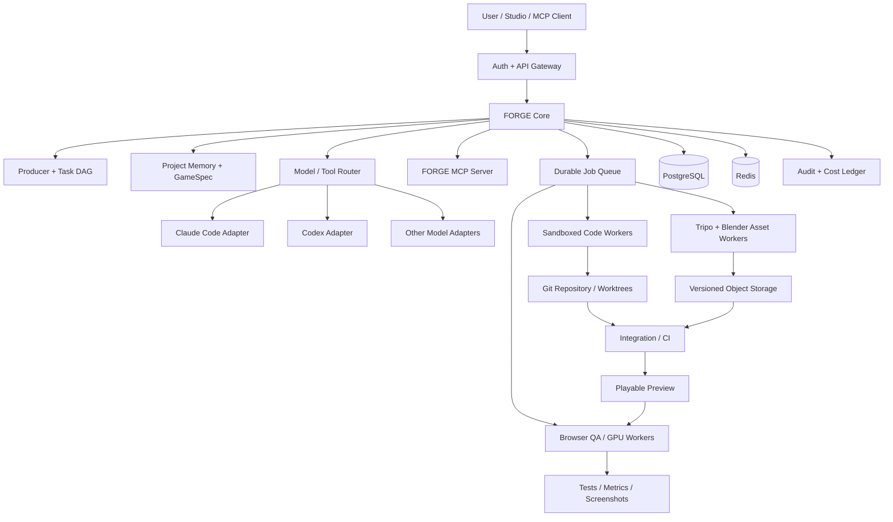

# FORGE — Autonomous Game Development Operating System

**Status:** Architecture blueprint / planning baseline  
**Version:** 0.1  
**Date:** 2026-11-19  
**Primary stack:** TypeScript, Three.js, WebGPU/WebGL, Node.js, PostgreSQL, MCP, Claude Code, Codex, Tripo

> **Mission:** Build a model-agnostic, type-safe multi-agent game-development platform that can plan, create, integrate, test, optimize, preview, export, and deploy polished browser-based 3D games. The system must produce reproducible projects, not disposable demos.

## 0. Executive decisions

### Product split
- **FORGE Core:** Agent runtime, typed game schemas, task DAG, project memory, MCP tools, integrations, sandboxing, asset pipeline, validation, observability, billing controls.
- **FORGE Studio:** Browser-based project dashboard, scene editor, agent activity, task board, asset library, live preview, visual QA, release center.
- **FORGE Runtime:** Portable, standalone TypeScript/Three.js game runtime and reusable gameplay packages.
- **FORGE MCP:** Public-facing server offering safe game-project tools to Claude Code, Codex, and compatible clients.

### Operating modes
1. **Director Mode:** User actively edits a scene and delegates precise tasks to agents.
2. **Autonomous Mode:** User provides a design brief; agents propose a plan, execute approved milestones, and request approval at gates.
3. **Assist Mode:** User works in Claude Code/Codex and calls FORGE tools via MCP.

### Non-negotiables
- No uncontrolled shared-file editing. Each code agent uses isolated worktrees or containers.
- Typed contracts and runtime validation at all trust boundaries.
- Human approval for spending beyond budgets, external deployment, destructive actions, and large design changes.
- Every artifact has ownership, provenance, versions, and validation status.
- Game projects are exportable and runnable independently of the hosted studio.
- Objective QA gates must pass before a task is considered integrated.
- WebGPU is progressive enhancement; define and test a WebGL-compatible fallback.
- No guarantee of AAA quality from a single prompt; measure against explicit art and performance targets.

## 1. Product requirements

### Personas
- Indie game developer: rapidly prototype and refine mechanics.
- Designer/technical artist: create and modify 3D worlds visually.
- AI-first developer: use MCP with Claude Code/Codex.
- Small studio: coordinate agent and human work with approval and audit history.
- Agency/brand: build interactive 3D web experiences.

### Primary user journey
1. Create a project and choose a template (exploration, FPS, survival, extraction, showroom).
2. Describe the game, reference images, platform targets, art style, mechanics, and budget.
3. Producer generates a Game Design Document (GDD), typed GameSpec, milestones, task dependency graph, risk register, and cost estimate.
4. User reviews scope and approves a bounded milestone.
5. Specialists work in parallel on code, scenes, assets, UI, backend, and tests.
6. Build integration validates changes and publishes a preview.
7. Visual playtester executes scripted actions and reports defects/performance.
8. Repair tasks are created, implemented, and retested.
9. User edits in Director Mode, approves a release, and exports/deploys the game.

### Success criteria
- From a supported template, generate a reproducible playable preview without manual code intervention.
- Agents can add a new object, behavior, or material without corrupting existing scenes.
- Introduced bugs are reproducibly detected and repaired with passing regression tests.
- Every asset and code change can be traced to task, agent, version, and validation results.
- Exported game builds without FORGE SaaS credentials.
- Measured budgets for build time, agent cost, load time, memory, and frame time.

## 2. System architecture



### Deployment topology
- **Control plane:** Studio frontend, authenticated APIs, scheduler, orchestration, database, asset metadata, event stream.
- **Execution plane:** Ephemeral, sandboxed coding containers; CPU asset-processing workers; browser/GPU test workers.
- **Storage plane:** Git repos, PostgreSQL, Redis, S3/R2 objects, logs/traces, screenshots and build artifacts.
- **Delivery plane:** Preview deployment, CDN, production releases, downloadable source/project export.
- Separate tenant-specific workspaces and secrets. Workers must use short-lived scoped credentials.

### Recommended initial stack
| Concern | Initial choice | Later options |
|---|---|---|
| Monorepo | pnpm + Turborepo | Nx |
| Language | TypeScript strict mode | Rust/WASM for hot paths |
| Studio | Next.js + React + Tailwind | Desktop wrapper later |
| Rendering | Three.js WebGPURenderer with fallback | Engine-specific plugins |
| Scene interaction | Three.js + custom editor tools | React Three Fiber selectively |
| Physics | Rapier WASM | Alternative physics adapter |
| Multiplayer | Optional Colyseus | Custom authoritative servers |
| API | Fastify + tRPC | REST/OpenAPI for external SDKs |
| Validation | Zod + JSON Schema | Schema registry |
| Database | PostgreSQL + Drizzle | pgvector if justified |
| Queue | BullMQ + Redis | Temporal when durable orchestration needs increase |
| Object storage | S3-compatible / R2 | Provider abstraction |
| Code agents | Claude Agent SDK / Codex adapter | Provider-neutral agent interface |
| AI SDK | Vercel AI SDK where suitable | Direct provider APIs for unique features |
| 3D generation | Tripo API | Multi-provider asset adapters |
| DCC automation | Blender headless | Additional DCC adapters |
| Testing | Vitest, Playwright, TypeScript checks | GPU visual-diff lab |
| CI/CD | GitHub Actions + container deployment | Self-hosted runners |
| Observability | OpenTelemetry + structured logs | Managed traces/dashboard |

**Note:** Validate current provider SDK features, pricing, licensing, supported formats, and model capabilities during implementation; do not assume one SDK covers every provider-specific workflow.

## 3. Monorepo structure

```text
forge/
  apps/
    studio/                 # Next.js user experience
    api/                    # Fastify/tRPC control-plane API
    worker/                 # Queue consumers and orchestration
    mcp-server/             # MCP tools and resources
    preview-host/           # Preview/release integration
  packages/
    contracts/              # Zod schemas, JSON Schema, events, IDs
    core/                   # Orchestrator, task graph, policy engine
    agent-runtime/          # Agent adapter interfaces and tool router
    provider-claude/
    provider-codex/
    provider-tripo/
    game-runtime/           # Three.js game application runtime
    game-ecs/               # Components, systems, entity schema
    game-editor/            # Scene graph, gizmos, inspector, undo/redo
    game-assets/            # Asset manifest, import, GLB utilities
    game-rendering/         # Render profiles, materials, lighting
    game-physics/           # Rapier integration
    game-input/             # Keyboard, mouse, touch, gamepad
    game-audio/
    game-network/           # Optional multiplayer interfaces
    game-ui/                # HUD/menu components
    test-harness/           # Deterministic browser input and telemetry
    telemetry/              # Metrics, traces, audit events
    templates/              # Tested game templates
    sdk/                    # Public typed client
  services/
    blender-worker/
    browser-test-worker/
    sandbox-manager/
  infra/
    docker/
    terraform/
    ci/
  docs/
    adr/
    specs/
    runbooks/
  examples/
    outpost-zero/
```

## 4. Type-safe contracts: the system's backbone

### Principles
- All agents exchange structured task envelopes, not only free-form prose.
- Validate model output at runtime, even if a provider claims structured output.
- Never execute arbitrary model-generated code or scene mutations without validation and policy checks.
- Use stable entity/asset IDs and schema versioning.
- Keep tool inputs and outputs versioned; migrations are explicit.
- Scene edits are typed transactions with preconditions, postconditions, rollback and idempotency keys.
- Type safety is necessary but not sufficient: semantic, security, performance, and visual checks are separate gates.

### Core domain schemas
- `ProjectSpec`: project ID, template, platform targets, genre, art bible, budgets, settings.
- `GameSpec`: scenes, systems, entity archetypes, components, controls, events, assets, performance targets.
- `TaskSpec`: ID, owner role, dependencies, requirements, output artifact types, acceptance tests, budget, priority.
- `AgentRun`: run ID, model, tool grants, inputs, outputs, tokens, costs, timestamps, logs, result.
- `AssetSpec`: asset ID, type, prompt/reference, scale, origin, materials, poly/texture budgets, rig, collision, license.
- `SceneMutation`: typed add/remove/update operations with entity IDs and version preconditions.
- `BuildReport`: commit, target, compilation, test suite, artifacts, errors, telemetry.
- `PlaytestScenario`: spawn, inputs, expected events, screenshot checkpoints, timeout, performance bounds.
- `ReleaseManifest`: source commit, asset versions, environment, provenance, approval, deployment URLs.

### Example task schema
```ts
import { z } from 'zod';

export const TaskSpec = z.object({
  schemaVersion: z.literal('1.0'),
  taskId: z.string().uuid(),
  projectId: z.string().uuid(),
  title: z.string().min(3),
  ownerRole: z.enum(['producer','gameplay','rendering','asset','world','backend','ui','qa','integration']),
  dependencyIds: z.array(z.string().uuid()),
  instructions: z.string().min(1),
  acceptanceCriteria: z.array(z.string().min(1)).min(1),
  maxCostUsd: z.number().nonnegative(),
  maxAttempts: z.number().int().min(1).max(10),
  requiresApproval: z.boolean(),
});
export type TaskSpec = z.infer<typeof TaskSpec>;
```

### Example scene mutations
```ts
const Vec3 = z.tuple([z.number().finite(), z.number().finite(), z.number().finite()]);
const SceneMutation = z.discriminatedUnion('type', [
  z.object({type:z.literal('add_entity'), entityId:z.string(), assetId:z.string(), position:Vec3}),
  z.object({type:z.literal('move_entity'), entityId:z.string(), position:Vec3}),
  z.object({type:z.literal('set_material'), entityId:z.string(), materialId:z.string()}),
  z.object({type:z.literal('remove_entity'), entityId:z.string()}),
]);
```

### Scene transaction lifecycle
1. Check caller permissions and per-project policy.
2. Validate schema version, referenced entities, assets and component compatibility.
3. Check expected scene revision to prevent stale writes.
4. Apply mutation in a temporary scene snapshot.
5. Run semantic invariants (no duplicate IDs, valid transforms, no broken references).
6. Commit transaction and emit audit event, or roll back on failure.
7. Queue appropriate dependent tests and previews.

## 5. Agent organization and responsibilities

### Coordination hierarchy
- **Executive Producer:** scopes milestones, plans DAG, budgets tasks, requests approvals, tracks completion and escalations.
- **Game Director:** creates GDD, mechanics, level beats, progression, art bible, acceptance criteria.
- **Technical Architect:** architecture decisions, schema design, module ownership, integration reviews.

### Specialist roles
| Agent | Inputs | Outputs | Verification |
|---|---|---|---|
| Gameplay Engineer | GameSpec, task | ECS systems, input, interactions | Unit + playtest |
| Rendering Engineer | Scene, target profile | Lighting, shaders, render config | Screenshot + frame budget |
| 3D Asset Artist | AssetSpec, references | Generated 3D candidate | Asset validator |
| Technical Artist | Candidate model | Optimized GLB, LOD, materials | Import, budget, rig checks |
| World Builder | Level plan, assets | Scene transactions | Collision + scene checks |
| UI/UX Engineer | UX flows, style guide | HUD, menus, editor UI | Visual + accessibility tests |
| Backend Engineer | API spec | Auth, persistence, endpoints | Integration/security tests |
| Network Engineer | Multiplayer spec | Rooms, replication, authority | Latency and exploit tests |
| NPC/AI Engineer | Behavior spec | State machines, navigation | Simulation tests |
| Audio Designer | Event map | Audio assets and event hooks | Asset and playback checks |
| QA Playtester | Scenarios | Defects, traces, screenshots | Reproducible evidence |
| Optimization Engineer | Profiles | LOD, compression, render changes | Before/after benchmarks |
| Release Engineer | Approved build | Preview/export/release | Smoke test + approval |
| Security Reviewer | Diff, policies | Risk findings | Policy and static scans |

### Agent execution policy
- Agents are ephemeral workers, not permanent expensive conversations.
- Spawn on demand according to task readiness, budget and worker capacity.
- Every run receives a least-privilege tool set, bounded context, resource limits and stop conditions.
- No direct write access to shared main branch or production assets.
- Every result must contain artifact references, summary, test evidence, and outstanding risks.
- Retry with bounded attempts and exponential backoff; failures escalate to producer/human.
- When two agents touch the same logical subsystem, serialize integration or coordinate explicit contracts.

## 6. Task graph and workflow engine

### Task states
`draft -> proposed -> approved -> ready -> running -> review -> validated -> integrated -> done`  
Exceptions: `blocked`, `failed`, `cancelled`, `needs_human`.

### Scheduler rules
- A task becomes ready only after all required dependencies are integrated or explicitly waived.
- Respect project-level concurrency, API rate limits, maximum dollar budgets and GPU slots.
- Critical path prioritization with separate urgent repair lane.
- Distinguish hard dependencies (asset ID required) from soft dependencies (placeholder acceptable).
- On task failure, preserve logs and checkpoints; do not blindly repeat destructive actions.
- Use idempotency keys for provider jobs and scene operations.
- Keep task revisions immutable; modifications create a new revision.

### Integration gates
1. Contract validation.
2. Static checks and unit tests.
3. Build and game startup smoke test.
4. Asset/reference integrity.
5. Browser interaction and visual QA when applicable.
6. Performance regression check when applicable.
7. Code review and required human approval.
8. Merge, update project graph, publish preview.

## 7. Project memory and context engineering

### Memory tiers
- **Canonical:** GameSpec, GDD, art bible, ADRs, entity schema, API contracts, approved decisions.
- **Operational:** Tasks, runs, failures, test results, recent changes, current blockers.
- **Retrieval:** Indexed docs, code symbols, asset metadata, scene hierarchy, logs.
- **Historical:** Prior experiments, rejected options, cost/performance benchmarks.

### Rules
- Canonical files and database records are authoritative; vector search is an index, not the source of truth.
- Every memory item has source, timestamp, project, revision and confidence/verification status.
- Context assembler retrieves only relevant project sections, affected code, dependencies, prior bugs and acceptance tests.
- Summaries cannot silently overwrite canonical specs.
- On completion, agents propose memory updates for validation before persistence.
- Add retention, deletion and tenant isolation controls.

## 8. Provider adapters, MCP and tool registry

### Provider adapter interface
```ts
interface AgentProvider {
  startRun(input: AgentRunRequest): Promise<AgentRunHandle>;
  getRun(id: string): Promise<AgentRunStatus>;
  cancelRun(id: string): Promise<void>;
  capabilities(): ProviderCapabilities;
}
```

### Claude Code adapter
- Run Claude Agent SDK in scoped workspaces.
- Supply approved tools and project context; use structured output when available.
- Capture patches, tool calls, cost usage, stdout/stderr, failure reason and run metadata.

### Codex adapter
- Support current official Codex execution/SDK interfaces as verified during implementation.
- Use the same task envelope and integration contract as Claude.
- Never assume Claude and Codex have identical tool permissions or lifecycle semantics.

### AI SDK and type-safe routing
- Use Vercel AI SDK for provider-neutral structured generation/tool calling where supported.
- Use Zod schemas to validate all outputs and normalize errors.
- For complex coding agents, call dedicated provider adapters instead of forcing everything through one abstraction.
- Track token usage, per-task spend, latency, failure rates and evaluation quality.

### MCP tools (first set)
| Tool | Purpose | Access |
|---|---|---|
| `forge.project.get_spec` | Read canonical GameSpec | read |
| `forge.tasks.list` | Read available tasks | read |
| `forge.tasks.claim` | Claim approved task | bounded write |
| `forge.assets.generate_3d` | Submit 3D generation job | paid/approval gated |
| `forge.assets.get_status` | Poll provider job | read |
| `forge.assets.validate` | Validate imported asset | worker |
| `forge.scenes.inspect` | Inspect scene/entity graph | read |
| `forge.scenes.apply_patch` | Typed transactional edit | write |
| `forge.game.run_preview` | Start isolated preview | worker |
| `forge.game.capture_frame` | Capture screenshot | read/worker |
| `forge.game.inject_input` | Drive test harness | sandbox only |
| `forge.game.get_metrics` | Read FPS/memory/errors | read |
| `forge.tests.run` | Execute named test suite | worker |
| `forge.deploy.create_preview` | Preview deployment | approval/policy |
| `forge.release.publish` | Production release | explicit human approval |

### MCP security
- Authenticate and authorize each tool call; validate project/tenant membership.
- Reject arbitrary filesystem paths, URLs and shell commands from untrusted inputs.
- Limit asset generation and deploy operations by policy and budget.
- Do not expose long-lived provider secrets to MCP clients or game runtime.
- Keep audit records for inputs, outcomes and approvals (redact secrets).
- Treat external content and agent outputs as untrusted; defend against prompt injection.

## 9. Three.js runtime architecture

### Runtime modules
- Bootstrap and lifecycle (`init`, `start`, `pause`, `resume`, `dispose`).
- ECS and system scheduler; deterministic update where feasible.
- Scene/level loading with stable IDs and asset references.
- Rendering profiles and WebGPU/WebGL capability detection.
- Camera modes: orbit, first-person, third-person, cinematic.
- Input abstraction: keyboard, mouse, touch, gamepad, remapping.
- Physics integration with collision layers and query APIs.
- Animation state machine and skeletal animation support.
- Audio event system and spatial sound.
- UI/HUD integration, localization and accessibility.
- Save/load and optional backend persistence.
- Optional multiplayer adapter with server authority.
- Debug overlay, metrics instrumentation and testing hooks.

### Runtime design rules
- Fixed physics timestep with interpolated rendering.
- No editor dependencies in exported production runtime.
- Load assets by manifest/version, not arbitrary hardcoded paths.
- Modular gameplay templates, no monolithic universal game engine.
- Use compressed GLB/glTF where practical; define Draco/Meshopt/KTX2 policy and device compatibility.
- Explicit fallback paths for missing WebGPU features.
- Safe cleanup of GPU resources, textures, materials and listeners.

### Initial reusable gameplay packages
1. Third-person controller and camera.
2. Interactables, prompts and pickups.
3. Health, damage and respawn.
4. Inventory and item definitions.
5. Basic enemy finite-state machine.
6. Doors, switches and triggers.
7. Save/load.
8. Simple quest/objective system.
9. FPS and interaction debug overlay.
10. Optional room-based multiplayer in a later milestone.

## 10. Scene editor and Director Mode

### Editor layout
- Top: project, branch, run/build status, play/pause, export.
- Left: scene hierarchy, asset browser, task panel.
- Center: 3D viewport with selection and gizmos.
- Right: inspector, materials, transforms, component settings.
- Bottom: console, timeline, tests, agent activity, logs.
- Side panel: context-aware chat, task approvals and visual feedback.

### Required editor features
- Select, move, rotate, scale; snapping, grids and coordinate systems.
- Hierarchy tree, grouping, prefabs, duplicate, rename, search.
- Material inspector, light and camera configuration.
- Drag/drop asset placement and scene serialization.
- Undo/redo via transaction history.
- Multi-selection, asset dependency warnings and broken-reference reporting.
- Live game preview and play-in-editor separation.
- Scene-aware requests: selected entity IDs and current scene revision included in agent context.
- Human/agent concurrent editing: optimistic concurrency and conflict resolution.

## 11. 3D asset pipeline (Tripo + processing)

### Asset lifecycle
`requested -> generating -> candidate -> processing -> validating -> review -> approved -> published`  
Failure states: `provider_failed`, `invalid`, `rejected`, `needs_repair`.

### Asset generation
- Inputs: prompt, reference images, art bible, scale, intended usage, target platform, polygon/texture budgets.
- Submit async provider job; store provider job ID and polling/webhook state.
- Normalize outputs into candidate asset records.
- Inspect license and provenance; preserve prompt, provider, model version, generation time and cost.
- Use Blender headless scripts for conversions, orientation, pivot, transforms, geometry cleanup, optional decimation and LOD.
- Export approved assets as glTF/GLB and compressed textures where supported.

### Validation checks
- File integrity and importability.
- Dimensions, origin/pivot, handedness and units.
- Vertex/triangle counts and material slots.
- UV availability, texture resolution and GPU memory estimate.
- Missing/invalid texture references.
- Skeleton/rig validity and animation compatibility.
- Collision representation and placement anchors.
- Rendered thumbnail from several camera angles.
- Visual/art-direction review (human or scored evaluation, not solely automated).

### Asset manifest
- Stable asset ID, semantic version, hash, source, author/provider, license, format, dimensions, tags, dependencies, preview images, budget metrics, status.
- Never overwrite published versions in place.
- Generate lower-cost placeholder assets to unblock gameplay tasks.

## 12. High-fidelity rendering and performance

### Rendering features (progressive)
- Physically based materials and HDR environment lighting.
- Tone mapping, exposure and color management.
- Directional/spot/point lighting, configurable shadow budgets.
- Baked lighting and probes where available/appropriate.
- Fog, particles, emissive surfaces and selective post-processing.
- Instancing, frustum culling, occlusion strategies where feasible.
- LODs, compressed textures and geometry, streaming/loading zones.
- Dynamic resolution and quality presets.
- Advanced shader library built with Three.js-supported shader/TSL workflows.

### Quality profiles
- **High desktop:** visually rich, target 60 FPS on documented reference hardware.
- **Balanced desktop:** stable 60 FPS with reduced effects.
- **Mobile:** simplified lighting, assets and effects; target 30 FPS on documented devices.

These are **targets, not guarantees**. Record hardware, browser, resolution, scene, and test methodology.

### Performance telemetry
- Frame-time median and p95, FPS distribution.
- Draw calls, triangle count, texture usage and GPU/JS memory where accessible.
- Startup time, total transfer size, asset load time, compilation errors.
- Long tasks, physics step time, animation update cost.
- Screenshot quality and visual regression diffs.
- Establish thresholds per template and device profile.

## 13. Automated browser playtesting

### Test harness
- Launch preview in a controlled browser with deterministic seed and fixed scenario.
- Inject virtual player inputs through a test-only API.
- Query entity positions, collisions, state transitions and gameplay events.
- Capture screenshots/video, browser console, network failures, performance traces.
- Assert expected results with timeouts and reproducible steps.
- Support browser/device matrix and visual baselines.

### Initial test scenarios
- App loads without fatal errors.
- Player spawns in valid position.
- Player can move and camera follows.
- Collision blocks walls and floors support the player.
- Player interacts with a door and picks up an object.
- Inventory updates and UI reflects it.
- Save/reload restores state.
- No broken GLB references or missing textures.
- Frame time remains within agreed test budget.
- Production export builds and starts.

### Repair loop
1. QA produces issue with exact steps, evidence, affected revision and severity.
2. Producer creates bounded repair task.
3. Engineer reproduces failure in sandbox and proposes fix.
4. Automated checks rerun; regression evidence attached.
5. Reviewer approves integration; issue closes only after verification.

### Important limits
- Automated agents cannot reliably judge every aesthetic or gameplay quality dimension.
- Visual similarity metrics may reward wrong solutions; require human checkpoints.
- Do not let playtest agents access real user accounts or production secrets.

## 14. Backend, multiplayer, security

### Control-plane services
- Authentication, organizations, projects, roles and membership.
- Projects and GameSpec versioning.
- Tasks, runs, approvals and notifications.
- Asset registry and signed object URLs.
- Provider configuration and per-user BYOK option.
- Billing, quotas, credit ledger and budget policy.
- Audit logs and usage analytics.
- Preview/release metadata and export jobs.

### Optional game backend
- Player auth and game session identity.
- Persistent player data and save slots.
- Leaderboards and achievements.
- Multiplayer matchmaking and rooms.
- Server-authoritative inventory/combat/state as needed.
- Rate limits, validation, cheat prevention and abuse controls.

### Security baseline
- Tenant-isolated execution and object access.
- Sandbox untrusted generated code; no unrestricted host Docker socket.
- Network egress restrictions and allowlists for workers.
- Signed artifact provenance and malware/dependency scans.
- Secrets vault; ephemeral credentials; no credentials in exported games.
- CSP, CSRF protections, safe file uploads and content validation.
- Spend controls and API abuse prevention.
- Human approval for external writes and destructive operations.
- License review for model outputs, textures, sound and third-party code.

## 15. Studio user experience

### Screens
1. **Welcome / Project Gallery:** create, duplicate, import, templates.
2. **Project Overview:** progress, milestones, budget, latest preview, issues.
3. **Director Workspace:** 3D editor, scene graph, inspector, contextual agent chat.
4. **Agent Control Center:** agents, tasks, run logs, permissions, retries, pause/cancel.
5. **Production Board:** DAG/Gantt/Kanban, blockers, dependencies, approvals.
6. **Asset Studio:** generation, processing, previews, versions, validation, tags.
7. **Playtest Lab:** scenarios, screenshots, recordings, metrics, defect triage.
8. **GameSpec Editor:** design, mechanics, schemas, art bible, quality profiles.
9. **Integrations:** Claude/Codex, Tripo, GitHub, deployment, API keys, MCP.
10. **Release Center:** build artifacts, changelog, export, preview, production approval.
11. **Usage & Billing:** token spend, generation credits, budgets, quotas.
12. **Admin / Organization:** RBAC, audit, tenant settings, retention.

### UX principles
- Always show what agents are doing and why.
- Every AI-generated change has preview, diff and undo/revert path.
- Separate 'proposed' from 'applied' actions.
- Show estimated cost before expensive operations.
- Use a real editor, not chat as the sole interface.
- Preserve direct manual control over scenes and code.

## 16. Database model (initial)

| Entity | Essential fields |
|---|---|
| users | id, auth provider, profile, created_at |
| organizations | id, owner_id, plan, limits |
| memberships | user_id, org_id, role |
| projects | id, org_id, repo, template, status |
| project_revisions | id, project_id, gamespec_hash, commit, created_at |
| specs | id, project_id, type, schema_version, content, revision |
| tasks | id, project_id, revision, state, owner_role, dependencies, budget |
| agent_runs | id, task_id, provider, model, status, tokens, cost, logs_ref |
| approvals | id, project_id, operation, requester, approver, state |
| assets | id, project_id, type, status, current_version |
| asset_versions | id, asset_id, hash, storage_ref, metadata, provenance |
| scene_transactions | id, scene_id, base_revision, mutation, result_revision |
| builds | id, project_id, commit, target, status, artifact_ref |
| tests | id, build_id, scenario, status, evidence_ref, metrics |
| releases | id, project_id, build_id, version, environment, approval |
| tool_calls | id, agent_run_id, tool, input_hash, result, timestamp |
| usage_ledger | id, org_id, project_id, provider, units, cost, timestamp |
| audit_events | id, actor, project_id, event, redacted_payload, timestamp |

Create migrations, indexes, foreign keys, retention policy, and tenant-scoped authorization tests before production.

## 17. API surface

### Public/control API
- `POST /projects`, `GET /projects/:id`, `POST /projects/:id/plan`
- `GET /projects/:id/spec`, `POST /projects/:id/spec/revisions`
- `GET /projects/:id/tasks`, `POST /tasks/:id/approve`, `POST /tasks/:id/cancel`
- `GET /agent-runs/:id`, `POST /agent-runs/:id/cancel`
- `POST /assets/generate`, `GET /assets/:id`, `POST /assets/:id/approve`
- `GET /scenes/:id`, `POST /scenes/:id/transactions`
- `POST /builds`, `GET /builds/:id`, `POST /tests/run`
- `POST /releases/preview`, `POST /releases/publish`
- `GET /usage`, `GET /audit`

### Real-time event stream
`task.created`, `task.started`, `task.blocked`, `task.completed`, `agent.tool_call`, `asset.generated`, `asset.validated`, `build.failed`, `test.failed`, `approval.requested`, `release.ready`.

Use SSE initially for one-way status streaming; WebSockets when bidirectional editor collaboration requires them.

## 18. Quality assurance, evaluation and observability

### Engineering gates
- Strict TypeScript, lint, format, unit tests.
- API contract compatibility and schema migration tests.
- End-to-end project creation -> preview -> export test.
- Dependency and secret scans.
- Asset validator tests and malicious upload cases.
- Agent tool authorization and prompt-injection tests.
- Concurrency/conflict tests for scene transactions.
- Failure recovery: worker crash, provider timeout, rate limit, duplicate webhook.

### Agent evaluation benchmark
Maintain a curated suite of tasks with known expected outcomes:
- Add interactable door to a template.
- Fix broken collision without changing unrelated movement.
- Generate a prop within triangle and dimension budgets.
- Modify lighting while preserving mobile performance.
- Repair a failed build with minimal patch.
- Export a standalone project with no missing dependencies.

Track completion rate, validated success rate, median cost, time, number of retries, regression rate, and human intervention rate. Prefer **validated outcomes** over persuasive agent narratives.

### Observability
- Correlation IDs across project -> task -> run -> tool call -> artifact -> build.
- OpenTelemetry traces and structured redacted logs.
- Cost/usage ledger and budget alarms.
- Dashboard for queue latency, provider failures, test failures, build success, GPU utilization.
- Alerts for runaway agents, repeated failed tasks, unexpected spending and unsafe operations.

## 19. Product pricing and economics (hypotheses)

### Potential packaging
- **Open-source Core/SDK:** local templates, typed contracts, basic MCP tools.
- **Creator:** hosted projects, limited concurrency and usage.
- **Pro:** larger generation budgets, asset pipeline, playtest lab, advanced exports.
- **Team:** collaboration, permissions, approvals, shared budgets.
- **Enterprise:** isolated workers, audit/SSO, custom provider routing and SLAs.

### Usage-based cost dimensions
- Model tokens and coding-agent execution.
- Tripo generation/processing credits.
- CPU/GPU minutes for Blender, rendering and browser tests.
- Storage, bandwidth and deployment.
- Concurrent sandbox hours and long-running multiplayer servers.

### Guardrails
- Budget estimate and cap per milestone.
- Per-agent maximum retries and spend.
- Cache validated outputs and reuse approved assets.
- Use cheaper deterministic tools where AI is unnecessary.
- Separate provider pass-through costs from platform margin.
- Validate willingness to pay before committing to pricing tiers.

## 20. Roadmap and exit gates

### Phase 0 — Technical spikes (1–2 weeks, estimate)
**Deliver:** browser rendering benchmark, provider SDK proof-of-concept, Tripo-to-GLB import, isolated agent worker, typed scene transaction prototype.  
**Exit:** all critical integrations are demonstrated; biggest cost/performance/security risks documented.

### Phase 1 — Vertical slice (3–6 weeks, estimate)
**Deliver:** monorepo, auth, projects, GameSpec, task DAG, producer/gameplay/QA agents, Three.js starter, player controller, simple interaction, preview, tests.  
**Exit:** create a project from a structured brief, implement an interaction, build and test it, export reproducibly.

### Phase 2 — Asset Studio (3–5 weeks, estimate)
**Deliver:** Tripo adapter, generation queue, asset metadata, Blender processing, validation, previews, scene placement.  
**Exit:** generate and place a coherent asset pack with technical budgets and provenance.

### Phase 3 — Autonomous repair (3–5 weeks, estimate)
**Deliver:** browser playtest agent, screenshot evidence, bug triage, isolated patch workflow, automated retesting.  
**Exit:** known regression is detected, repaired and validated without manual code editing.

### Phase 4 — Director Mode (4–8 weeks, estimate)
**Deliver:** robust scene editor, inspector, selection-aware agent actions, undo/redo, multi-user-safe revisions.  
**Exit:** user and agents safely edit the same project through controlled transactions.

### Phase 5 — Beta and monetization (4–8 weeks, estimate)
**Deliver:** onboarding, quotas, billing, export, deploy, templates, docs, MCP integration, telemetry, security hardening.  
**Exit:** external beta users independently complete supported workflows and pay for measured value.

**Estimates are directional and assume focused implementation, limited initial scope, and no major provider blockers. Parallelizing phases does not remove integration risk.**

## 21. Initial sprint backlog

### Sprint A: Foundation
- [ ] Create pnpm/Turborepo monorepo with strict TypeScript and shared configs.
- [ ] Implement `packages/contracts` with versioned Zod schemas.
- [ ] Create minimal Three.js runtime and browser preview.
- [ ] Implement typed scene entity IDs and transaction reducer.
- [ ] Add Vitest, Playwright and CI checks.
- [ ] Write ADRs for ECS, rendering fallback, task queue, storage and agent sandbox.

### Sprint B: Orchestration
- [ ] Create PostgreSQL schema and Drizzle migrations.
- [ ] Implement task DAG and dependency scheduler.
- [ ] Implement task lifecycle and immutable run records.
- [ ] Add provider-neutral agent interface.
- [ ] Integrate one coding agent end-to-end.
- [ ] Add run cancellation, timeout, budget and retry policies.
- [ ] Isolate code workers and Git worktrees.

### Sprint C: First playable game
- [ ] Create `outpost-zero` template and GameSpec.
- [ ] Implement third-person controller and camera.
- [ ] Implement doors, pickups and interaction prompts.
- [ ] Add UI/HUD and basic save/load.
- [ ] Build preview and standalone export pipeline.
- [ ] Add deterministic browser smoke/playtest scenarios.

### Sprint D: Asset pipeline
- [ ] Add Tripo provider adapter and credential handling.
- [ ] Implement async generation and status tracking.
- [ ] Create asset registry and immutable versions.
- [ ] Add Blender processing and GLB import validation.
- [ ] Add asset preview renderer and review gate.
- [ ] Integrate asset placement with typed scene mutations.

### Sprint E: Multi-agent quality loop
- [ ] Add Claude/Codex provider adapters as supported.
- [ ] Implement task-specific tool grants and MCP server.
- [ ] Add producer task planning with human approval.
- [ ] Add QA agent that captures browser evidence.
- [ ] Create defect-to-repair task flow.
- [ ] Add merge gate and regression test reruns.

## 22. Risks and mitigation

| Risk | Impact | Mitigation |
|---|---|---|
| Agents produce incompatible code | Broken builds | Typed contracts, isolated branches, CI gates |
| Generated assets look inconsistent | Poor visual quality | Art bible, review, asset constraints, reuse |
| Tripo output isn't game-ready | High processing effort | Blender pipeline, strict validation, fallbacks |
| Agent loops overspend | Unbounded cost | Hard budget caps, retries, approvals, kill switch |
| Browser GPU performance varies | Inconsistent gameplay | Quality tiers, reference hardware, profiling |
| Scene edits conflict | Lost work | Revision preconditions, transactions, rollback |
| Provider changes/API downtime | Workflow failures | Adapter interfaces, version pinning, fallbacks |
| Prompt injection through external files | Security breach | Sandboxes, permissions, untrusted-data handling |
| Licensing uncertainty | Commercial exposure | Provenance, license registry, legal review |
| Scope grows into a full game engine | Long delay | Template-driven MVP and explicit exclusions |
| Automated tests miss bad gameplay | Weak user experience | Human playtest gates and qualitative review |

## 23. MVP exclusions

Do **not** build these in the first vertical slice:
- Full MMO networking or 300-player servers.
- Custom renderer or custom physics engine.
- Complete procedural open-world generation.
- Advanced cinematic animation authoring.
- Full DAW or professional audio generation suite.
- Arbitrary Unity/Unreal project conversion.
- Completely unsupervised production publishing.
- General-purpose game AI training platform.
- Large plugin marketplace before core reliability is established.

## 24. Architectural decision records to write first

1. **ADR-001:** Three.js renderer strategy and WebGPU fallback.
2. **ADR-002:** ECS vs scene-object-oriented runtime design.
3. **ADR-003:** Zod schemas, GameSpec versioning and migrations.
4. **ADR-004:** Task DAG persistence and queue technology.
5. **ADR-005:** Claude/Codex adapter lifecycle and sandbox model.
6. **ADR-006:** Git worktree integration, conflict resolution and merge gates.
7. **ADR-007:** Asset formats, compression, provenance and budgets.
8. **ADR-008:** Scene transaction protocol and undo/redo.
9. **ADR-009:** Browser playtest harness and deterministic test API.
10. **ADR-010:** Hosted vs self-hosted execution and BYOK security.

## 25. First demonstration game: OUTPOST ZERO

**Genre:** Third-person sci-fi exploration, single-player.  
**Environment:** One compact research outpost, modular corridors, one exterior courtyard.  
**Art direction:** Realistic industrial sci-fi, consistent PBR materials and restrained atmospheric lighting.  
**Mechanics:** Walk/run, camera, interact, open doors, collect keycard, unlock terminal, complete objective.  
**UI:** Main menu, pause, objective indicator, interaction prompt, inventory slot.  
**Backend:** None required for the first playable build; optional cloud saves later.  
**Assets:** Placeholder geometry first, then validated GLB replacements.  
**Tests:** Spawn, movement, collision, door, pickup, inventory, objective, reload, build, performance.  
**Definition of done:** One-command local build, playable browser preview, passing automated tests, source export, asset manifest and cost report.

## 26. Open questions to settle before detailed implementation

1. Is the first commercial product the **Studio UI**, the **MCP developer toolkit**, or both with one prioritized launch path?
2. Is the initial target **desktop browser only**, or desktop and mobile?
3. Should FORGE projects use a **strict internal ECS** or support arbitrary Three.js code as first-class projects?
4. Should users bring their own Claude/Codex/Tripo keys, use platform-managed credits, or both?
5. What is the maximum permitted cost per autonomous milestone?
6. Which asset styles are first-class: photorealistic, stylized, low-poly, or configurable?
7. Will the first release support only single-player games?
8. Should the project repository live in the user's GitHub account or a managed workspace?
9. Which hosting/deployment targets are supported at launch?
10. Which components should be open-source, source-available, or proprietary?

## 27. Recommended immediate next steps

**Week 1:** Write ADR-001 through ADR-005, create monorepo and GameSpec, benchmark a Three.js scene in desktop browsers, test Claude/Codex adapters, and run one Tripo asset through validation.  
**Week 2:** Build task DAG, minimal editor/preview, sandboxed coding worker, scene transaction API and smoke test.  
**Week 3:** Build OUTPOST ZERO with placeholder assets; have one agent implement a gameplay task and another verify it.  
**Week 4:** Add Tripo integration, approval UI, logs, cost ledger and reproducible export.  

**North-star metric:** Percentage of requested game-development tasks that produce an integrated, validated, user-approved improvement to a playable project, at an acceptable cost and time.

---

*This document is the planning baseline. Before implementation, split it into product requirements, ADRs, milestone specifications, data contracts, and an executable issue backlog. Update it whenever architectural decisions change.*
